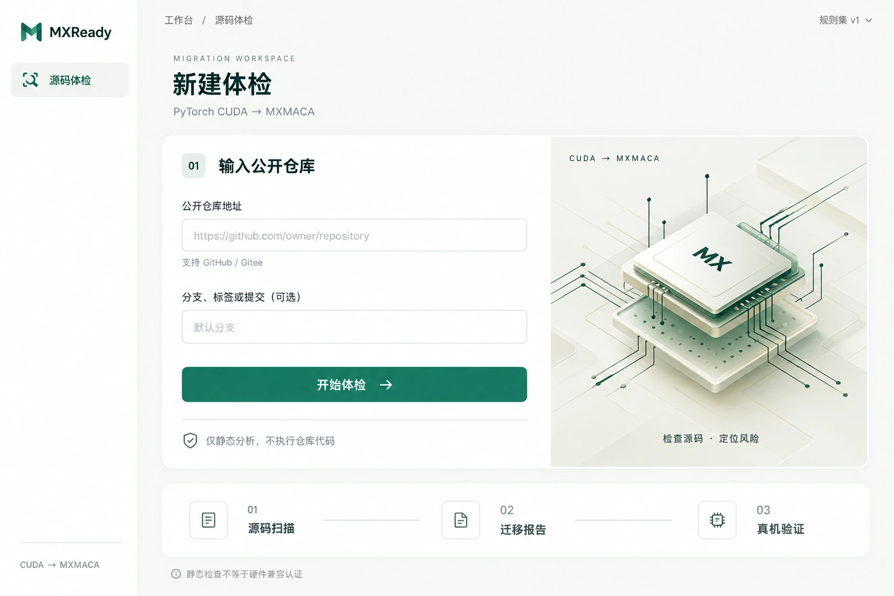
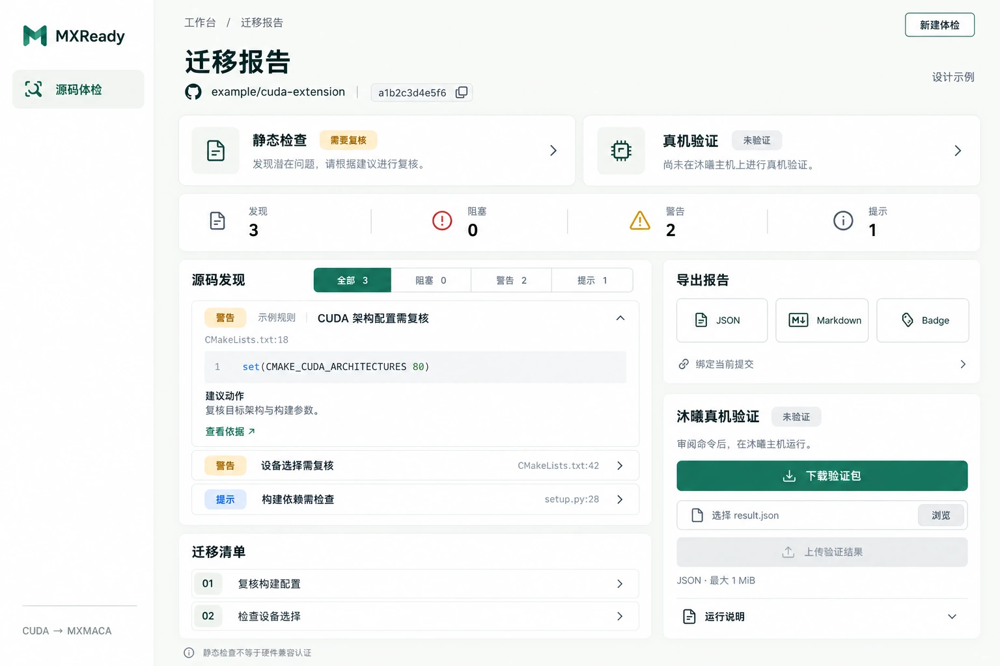

# MXReady 前端重设计技术方案

日期：2026-10-25  
阶段：已按方案实施并完成前端验收。旧版页面结构与样式已替换，扫描状态、接口、后端与 runner 保持原有实现；应用依赖及锁文件未变更。

## 1. 设计目标

将旧版深色宣传式首页替换为浅色开发者工作台。用户进入页面后，直接输入公开仓库，查看迁移风险，再下载报告或进入真机验证流程。去掉重复口号、大段产品介绍、装饰性统计和重复的英文栏目标题；保留操作说明、错误信息和结论边界。

重做页面布局与视觉样式，继续使用现有 React 19、TypeScript、Vite 和功能组件。无需迁移框架、增加 UI 框架、接入外部字体服务或改变部署方式。

## 2. 设计交付

已查找本地 skill 并阅读 `imagegen` 与 `sites` 的相关指导：前者用于生成 UI 设计图，后者用于任务导向、响应式和可访问性设计。此次针对已有本地项目出方案，不创建或发布 Sites 站点。

| 交付物 | 内容 |
| --- | --- |
| [新建体检设计图](design/frontend-refresh/new-scan.webp) | 品牌侧栏、仓库表单、芯片插画、三步流程 |
| [迁移报告设计图](design/frontend-refresh/report.webp) | 静态与硬件状态、结果筛选、证据、迁移清单、导出、验证 |

两张图由内置生图模型生成，已人工查看。它们是布局和风格参考，不是运行截图；报告中的仓库、提交、规则、证据和数量均为设计示例。

### 新建体检



### 迁移报告



### 设计图到实现的修正

- 首页右上角规则集只读展示，移除图中的下拉箭头；保留从 `/api/rules` 获取的实际规则数，加载失败时不显示虚构数量。
- 移除报告状态卡、提交绑定说明和迁移清单行上的无功能箭头；不新增复制按钮。提交仍显示缩写，通过现有 `title` 保留完整哈希。
- 首页英文眉题、插画下的重复标语可删除，保留中文页标题和必要的技术名称。
- 报告需补齐扫描时间、规则版本、工具版本和扫描范围提示。设计图未展开这些内容，不代表取消功能。
- 报告图中一条展开、两条收起仅用于演示两种样式；实现继续保留现有发现卡默认展开的行为。
- 图中的芯片是装饰性概念，不代表真实沐曦芯片外观，也不暗示已连接硬件。概念图中的 M 图形不是最终品牌资产。
- 不将整张设计图作为页面背景。文字、表单、按钮和数据均以真实 HTML/React 渲染；插画需要另行生成独立资产后本地打包。

## 3. 视觉规范

视觉方向：米白画布、白色面板、深森林色文字、青绿色主操作。用留白和排版建立层级，不以大面积渐变或装饰文案填充空间。

| 项目 | 建议值 |
| --- | --- |
| 页面背景 | `#F7F8F5` |
| 面板背景 | `#FFFFFF` |
| 主文字 | `#182B27` |
| 次要文字 | `#596C65`，实现时检查对比度 |
| 主色 / 按钮 | `#16745B`，按钮文字白色 |
| 边框 | `#DCE4DE` |
| 阻塞 / 警告 / 提示 | 深红 / 琥珀 / 蓝灰，并始终配文字标签 |
| 卡片圆角 | 16px；控件圆角 8px |
| 间距 | 4、8、12、16、24、32、48、64px |
| 标题 | 页面 32–40px；区域 18–20px |
| 正文与表单 | 14–16px；辅助文本不小于 12px |
| 控件高度 | 输入框与主要按钮 48px；可交互目标至少 44px |
| 字体 | 系统无衬线及中文回退；代码使用系统等宽字体 |

用 CSS 自定义属性集中管理颜色、间距和圆角。阴影只用于轻微区分面板；正文不使用低对比度浅灰。装饰不参与键盘顺序，对辅助技术隐藏。

## 4. 页面结构与交互

### 4.1 公共外壳

桌面采用约 216px 的轻侧栏，保留 MXReady 品牌与“源码体检”单一工作区。侧栏只表示当前工作区，不添加历史、账户、设置等未实现入口。扫描过程中不增加会误导用户的“取消任务”按钮。

主区域包含上下文标题和内容。报告页的“新建体检”复用 `reset()`；首页品牌链接继续回到首页。不得误把离开页面或中止浏览器请求解释为服务端任务取消。

### 4.2 新建体检

核心是左侧输入表单，右侧为可移除的芯片装饰。仅保留两个字段：公开仓库地址，以及可选分支、标签或提交。

- 保留 URL 输入类型、必填校验、前后空白清理及 ref 的 200 字符限制。
- 保留 GitHub/Gitee 支持范围提示。空 ref 按现有行为提交 `null`。
- 提交期间禁用按钮并显示“正在创建任务”，保留防重复提交行为。
- 保留服务器返回的错误码和可访问错误信息。
- 表单下保留“仅静态分析，不执行仓库代码”；流程旁保留“静态检查不等于硬件兼容认证”。

底部三步流程为说明性内容，不模拟导航或任务进度。

### 4.3 扫描、恢复与异常

进度页沿用五阶段：任务排队、安全获取、源码索引、规则分析、生成报告。展示后端 `stage_message`，用完成、进行中、等待的文字和图标表达状态，不制造百分比进度或预计耗时。

恢复与报告加载使用浅色骨架屏，保持 `ReportSkeleton` 的可访问语义。错误页包含错误码、原因，以及现有条件允许的“继续查看扫描”和“重新开始”。

`useScan` 的六种视图保持完整：`idle`、`restoring`、`scanning`、`report-loading`、`report`、`error`。继续保留 URL 中的 `?scan=`、刷新恢复、浏览器历史响应、轮询清理、有界重试和卸载时中止请求。

### 4.4 迁移报告

页面先展示仓库、提交和两种独立状态，再展示发现数。静态状态来自 `static_status`；真机状态来自 `verification_status`。不根据警告数自行推断硬件结论，不生成兼容率。

| 区域 | 保留内容与行为 |
| --- | --- |
| 报告身份 | 仓库外链、提交缩写及完整哈希、扫描时间、规则和工具版本 |
| 状态 | 静态 passed/warnings/blocked/failed；硬件 not-run/verified/failed/stale |
| 摘要 | 总数、阻塞数、警告数、提示数，全部使用 API 数据 |
| 源码发现 | 全部/阻塞/警告/提示筛选、数量、方向键/Home/End 操作 |
| 发现卡 | 规则 ID、级别、路径及行号、标题、消息、证据、建议、依据链接、展开收起 |
| 迁移清单 | 标题、具体动作、受影响文件；不添加无持久化支持的完成复选框 |
| 扫描范围 | 完整保留 `analysis_warnings` 的代码、路径和说明，不把不完整扫描表现为无风险 |
| 导出 | JSON、Markdown、Badge 三个原有资源地址 |
| 空状态 | 当前筛选没有结果，以及尚不代表完成真机兼容验证的提醒 |

桌面左栏承载发现与清单，右栏承载导出和验证。扫描范围提示放在主内容中显式可见的位置。报告自然纵向滚动，不为了塞入设计图高度而裁剪内容。

### 4.5 真机验证

保留验证包下载、文件选择、上传校验和结果刷新。保留 `.json` 扩展名检查、1 MiB 大小限制、无文件及上传中禁用提交、错误提示和上传后 `onUpdated` 更新报告。

下载区始终可见“审阅命令后，在沐曦主机运行”。“运行说明”可使用原生 `details/summary` 收纳完整步骤；不得删掉审阅 `SECURITY.md`/`mxready.yml`、人工确认和上传前检查脱敏的要求。命令维持现有内容：

```text
python -m mxready_runner inspect --manifest mxready.yml --output result.json
```

真机验证通过、失败和过期由服务端报告决定。前端继续显示现有的同提交及 30 天有效期说明，不另写有效期推导规则。网页不执行 runner。

## 5. 实现边界与组件映射

| 文件/组件 | 计划变化 | 保留部分 |
| --- | --- | --- |
| `frontend/src/App.tsx` | 替换旧 hero、页头和页脚，接入工作台外壳 | `useScan` 分支、规则获取、ErrorBoundary |
| `frontend/src/styles.css` | 完整替换旧视觉规则，统一设计变量及响应式 | 覆盖所有现有状态与组件的样式需求 |
| `ScanForm.tsx` | 精简标题文案，更新输入区布局 | 提交逻辑、字段语义、错误与禁用状态 |
| `ScanProgress.tsx` | 新阶段列表视觉，移除装饰轨道 | 五阶段映射、后端消息与 live region |
| `ReportView.tsx` | 新状态卡、摘要、左右栏布局 | 筛选、键盘逻辑、焦点、报告数据、下载地址 |
| `FindingCard.tsx` | 新卡片、徽标和代码区域样式 | 默认展开、展开收起、证据与依据链接 |
| `VerificationPanel.tsx` | 紧凑验证卡，步骤可展开 | 上传限制、下载、状态语义、回调 |
| `ReportSkeleton.tsx` / `ErrorBoundary.tsx` | 跟随新视觉及布局 | 加载与错误可访问语义、恢复能力 |

必要时新增轻量 `WorkspaceShell` 和本地装饰组件，不引入第二套扫描状态。旧首页结构和样式在实现阶段删除，不在旧 CSS 末尾堆叠覆盖规则。

本次方案不需要修改 `frontend/src/hooks/useScan.ts`、`frontend/src/api/`、生成契约、FastAPI、扫描引擎、持久化、runner 或打包逻辑。保留 `frontend/dist/` 构建输出约定，不把构建产物提交进 `src/`。

## 6. 接口契约

| 用途 | 现有请求 |
| --- | --- |
| 创建扫描 | `POST /api/scans`，请求体 `{ repo_url, ref }` |
| 任务状态 | `GET /api/scans/{id}` |
| 获取报告 | `GET /api/scans/{id}/report` |
| 规则目录 | `GET /api/rules` |
| 导出 | `GET /api/scans/{id}/report.json`、`report.md`、`badge.svg` |
| 验证包 | `GET /api/scans/{id}/verification-bundle` |
| 上传验证结果 | `POST /api/scans/{id}/verification-runs`，JSON 文件作为请求体 |

继续使用现有客户端超时、错误规范化与中止信号。上传不改成 multipart。下载继续使用真实链接，不生成伪下载或模拟成功状态。

## 7. 响应式与可访问性

| 视口 | 布局 |
| --- | --- |
| ≥1200px | 侧栏约 216px；首页表单与插画并排；报告主辅两栏 |
| 768–1199px | 侧栏收为顶栏；首页缩小或隐藏插画；报告在空间不足时单栏 |
| <768px | 顶部仅品牌与上下文；单列表单；状态卡上下排列；计数 2×2；工具区移到内容后 |

移动端左右留白 16px，禁止页面级横向溢出。长文件路径允许换行；代码块单独横向滚动。迁移清单移除旧样式中的固定最小行宽，按钮组允许换行，验证上传区改为单列。

保留真实 label、按钮、链接和文件输入。文件选择器不能只依赖透明 input 隐藏焦点，外壳需有 `:focus-within`。所有键盘交互有可见焦点，普通文字对比度目标至少 4.5:1，控件边界/状态与背景至少 3:1。

保留筛选的 `aria-pressed`、发现卡的 `aria-expanded`/`aria-controls`、进度的 `aria-live`、错误的 `role="alert"` 和报告标题的焦点处理。装饰设 `aria-hidden`，尊重减少动画偏好；以 200% 缩放和真实窄视口检查排版。

## 8. 后续实施顺序

1. 将现有测试中的业务断言与旧文案断言区分；先补必要的键盘、焦点、状态可达性回归，再实施 UI 替换。
2. 替换公共外壳与首页，确定设计变量、中文字体和移动端表单。
3. 同步改造进度、恢复、骨架和错误页。
4. 改造报告、发现、导出与验证面板，确保所有原有报告内容可达。
5. 用本地 fixture 校验不同状态及长内容；若采用插画，另行生成并优化独立本地资产。
6. 执行测试、构建和浏览器检查，通过后更新 `CHANGELOG.md` 记录用户可见变化。

## 9. 验收计划

实施后在 `frontend/` 执行：

```powershell
npm test
npm run typecheck
npm run build
```

现有测试重点包括 App 的刷新恢复、临时失败重试、重试上限、卸载中止、失败恢复与规则数；ScanForm 的提交；ReportView 的筛选/下载；FindingCard 的展开；VerificationPanel 的上传限制及状态。修改文案断言时保留其背后的业务和安全断言。

浏览器验证使用受控 API fixture，至少覆盖：

- 首页提交中、URL/ref 输入、错误状态及规则请求失败；
- 扫描五阶段、刷新恢复、骨架、任务失败、网络失败和继续查看；
- 四种静态状态、四种硬件状态、空筛选、长证据和扫描范围提示；
- 三种导出、验证包下载、上传成功、文件类型/大小失败和服务器拒绝；
- Tab、Enter、Space、方向键、Home/End、文件选择和报告自动焦点；
- 360、390、768、1024、1440px 视口及 200% 缩放，无页面级横向溢出、遮挡或不可达按钮。

jsdom 测试仅证明 DOM/交互，不作为布局验收证据；响应式需实际浏览器截图与尺寸检查。若改动意外触及后端或契约，应按仓库指南补跑对应质量门，不用前端构建代替。

## 10. 实施与验收结果

2026-10-25 完成实现。公共外壳、首页、进度、恢复、异常、报告、发现卡、导出与验证区已统一为浅色工作台；旧样式已整体替换。保留现有 useScan/API 逻辑、报告默认展开、轮询恢复、下载地址与上传限制。

首页插画由内置生图工具独立生成，压缩为 1086×1448 WebP（80,784 字节），位于 `frontend/src/assets/mx-chip.webp`。使用 Vite 静态 URL 引用，构建产物进入 `dist/assets/`，与 FastAPI 的 `/assets` 挂载及 wheel 包资源约定一致。没有新增后端静态路由。

<details>
<summary>插画生成提示词（需要重新生成资产时使用）</summary>

```text
Create a refined decorative illustration asset for the MXReady software developer workspace. Portrait composition approximately 3:4. A single abstract floating stack of three square microchip ceramic slabs in an isometric view, cream-white top face, frosted pale sage green edges, very dark forest green thin circuit traces elegantly extending toward the edges of the canvas. Top ceramic face bears just small letters 'MX' in dark green. Premium architectural product visualization, quiet technical sophistication, soft natural diffuse light, gentle shadows, warm off-white background #f3f5ef, extremely restrained green and cream palette. The chip occupies middle 65% with comfortable negative space above and below. Entirely decorative abstract conceptual chip, no representation of a real vendor hardware product. No UI, no panels, no borders, no buttons, no other text, no watermark, no blue or purple neon, no gradients or dark backdrop. High detail precise materials, clean lines, very low contrast background, similar to a luxury minimal engineering illustration.
```

</details>

两张概念设计图仅作为设计对照留档，其生成提示词不随仓库保留：图本身已归档为 WebP，页面由真实 React 实现，不再需要重新生成。

| 检查 | 结果 |
| --- | --- |
| 前端单元及交互回归 | 9 个文件，45 项测试通过；包括先失败再实现的新界面回归 |
| TypeScript | `npm run typecheck` 通过 |
| 生产构建 | `npm run build` 通过，插画输出为带哈希的 assets 文件 |
| 真实浏览器 | Chrome，23 组受控 API 检查通过，无 pageerror |
| 响应式 | 首页与报告在 360、390、768、1024、1440px 下无页面级横向溢出 |
| 极端内容 | 长路径、长证据、扫描范围提示及 200% CSS 缩放下无页面级横向溢出 |
| 键盘 | 跳至内容、筛选方向键/Home/End、发现卡 Enter/Space、原生运行说明 Enter/Space、文件选择焦点 |
| 功能状态 | 全部扫描阶段、失败重置、URL 恢复、加载骨架、静态/硬件 16 种状态组合、空结果 |
| 导出与验证 | 下载链接、JSON 类型与大小拒绝、服务器拒绝、上传后状态刷新、规则请求失败、报告重试 |

原生 summary 的 Enter/Space 在真实浏览器中验证；jsdom 测试检查其可聚焦性与点击展开，避免将模拟环境的键盘能力限制当作产品缺陷。

### 实际页面截图

- [桌面首页](design/frontend-refresh/implemented-home.webp)
- [移动端首页](design/frontend-refresh/implemented-home-mobile.webp)
- [桌面报告](design/frontend-refresh/implemented-report.webp)
- [移动端报告](design/frontend-refresh/implemented-report-mobile.webp)

这些截图是实际 React 页面在受控 API fixture 下的结果，仓库和报告内容来自测试数据。设计概念图保留用于对照。

六张图统一存为 WebP：真实页面截图用无损编码（逐像素与原 PNG 一致），概念设计图用 q92 有损（PSNR ≥ 44 dB），合计 463 KB，约为原 PNG 的 15%。生成命令为 `python scripts/optimize_docs_images.py`。

验收边界：本轮未运行真实公开仓库扫描、FastAPI 端到端、完整 Python 质量门、wheel/ZIP 安装冒烟或沐曦真机验证；本机 Python 环境未安装 FastAPI，后端代码亦未修改。已核对前端构建资产目录与现有服务/打包路径，不将此核对表述为安装测试通过。200% 为 CSS 缩放检查，不能代替所有浏览器的原生缩放与辅助技术测试。当前目录没有 `.git` 元数据，未创建分支或提交。
